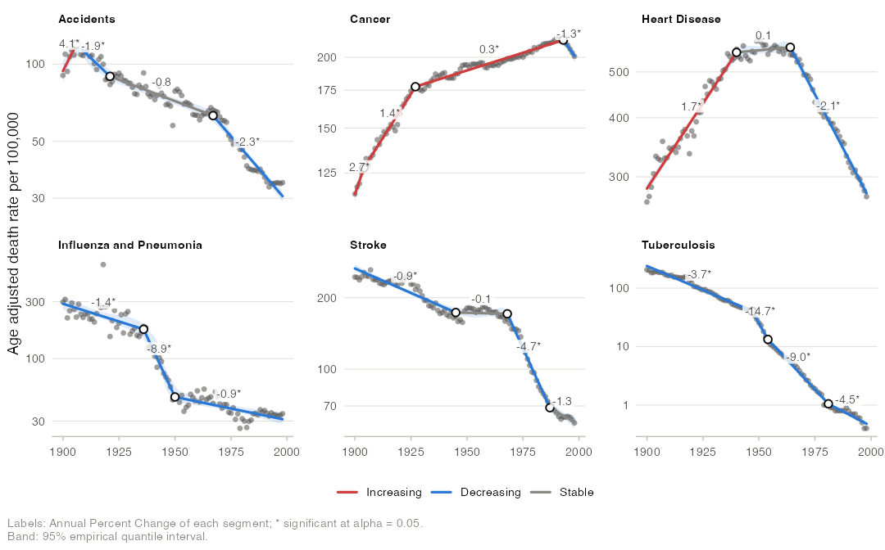

# joinpoint: Trend Analysis by Joinpoint Regression 

<!-- badges: start -->
[](https://CRAN.R-project.org/package=joinpoint)
[](https://skhademioore.r-universe.dev/joinpoint)
[](https://github.com/skhademioore/joinpoint/actions/workflows/R-CMD-check.yaml)
[](https://lifecycle.r-lib.org/articles/stages.html#experimental)
[-blue.svg)](https://www.gnu.org/licenses/gpl-3.0)
[](https://zenodo.org/badge/latestdoi/1412542926)
<!-- Badges to enable later (uncomment each):
[](https://skhademioore.github.io/joinpoint/)
[](https://archive.softwareheritage.org/browse/origin/?origin_url=https://github.com/skhademioore/joinpoint)
-->
<!-- badges: end -->

***joinpoint*** fits joinpoint (segmented line) regression models for trend
analysis (Kim et al. 2000). It finds the points in time at which a trend
changes, summarizes each period by its annual percent change (APC), fixed
periods by the average annual percent change (AAPC), and draws publication
quality figures with ggplot2.

It covers the classical least squares joinpoint model with its error models,
model selection rules and confidence intervals, together with the extensions
of the literature: Poisson and logistic joinpoint models, continuous
joinpoints, covariates, jump and comparability ratio models for coding
changes, pairwise comparisons of trends, and clustering of age groups.



## Installation

```r
# Development version
# install.packages("remotes")
remotes::install_github("skhademioore/joinpoint")
```

The grid search is compiled C++ (through Rcpp), so installing from source
needs a C++ toolchain:

- **macOS**: Xcode Command Line Tools (`xcode-select --install`)
- **Windows**: [Rtools](https://cran.r-project.org/bin/windows/Rtools/)
- **Linux**: `g++` and `make` (usually present by default)

## Quick start

```r
library(joinpoint)

fit <- joinpoint(us_mortality, x = year, y = rate, by = "cause", kmax = 3)
fit                      # joinpoints, APCs and AAPCs for each cause
apc(fit)                 # segment APCs with confidence intervals
aapc(fit)                # average annual percent changes
joinpoints(fit)          # joinpoint locations with confidence intervals
model_selection(fit)     # selection statistics for every model
jp_table(fit)            # formatted table for a manuscript

autoplot(fit, color_by = "trend", log_y = TRUE)
plot_apc(fit)
plot_aapc(fit)
```

## What is covered

| Method | Function or argument | Reference |
|---|---|---|
| Rates, age adjusted rates, proportions, percents, counts, other values | `joinpoint(type = )`, `age_adjust()` | |
| Linear and log-linear models | `log = ` | Kim et al. (2000) |
| Constant variance, standard errors, Poisson variance | `variance = ` | |
| First order autocorrelated errors (estimated or given), covariance matrix | `autocorrelation = `, `vcov = ` | |
| Exhaustive grid search with placement constraints and points between observations | `jp_control(min_obs_end, min_obs_between, n_grid)` | Lerman (1980) |
| Continuous joinpoints, exact least squares | `continuous = TRUE` | Hudson (1966) |
| Poisson and logistic joinpoint models, exact maximum likelihood, optional quasi-likelihood dispersion | `family = `, `overdispersion = ` | Czajkowski et al. (2008) |
| Covariates such as seasonal terms | `covariates = ` | |
| BIC, BIC3, weighted BIC, data dependent selection | `method = ` | Kim et al. (2023) |
| Modified BIC | `method = "mbic"` | Zhang and Siegmund (2007) |
| Sequential permutation test | `method = "permutation"` | Kim et al. (2000) |
| Sequential Monte Carlo likelihood ratio test | `method = "lrt"` | Czajkowski et al. (2008) |
| Early stopping of the Monte Carlo tests | `jp_control(n_exceed = )` | Besag and Clifford (1991) |
| Minimum APC difference worth detecting | `jp_control(madwd = )` | |
| Parametric intervals: APC, AAPC, joinpoint location | `ci_method = "parametric"` | Clegg et al. (2009); Lerman (1980) |
| Empirical quantile intervals and p values | `ci_method = "empirical"` | Kim et al. (2017, 2022) |
| AAPC for the full range, last N observations and custom ranges | `jp_control(aapc_full, aapc_last, aapc_ranges)` | Clegg et al. (2009) |
| Exclusion of data points, shifted x values | `exclude = `, `shift = ` | |
| Jump model and comparability ratio model | `jump = `, `comparability_ratio = ` | Chen et al. (2020) |
| Pairwise tests of parallelism and coincidence, AAPC comparison, multiplicity adjustment | `jp_compare()` | Kim et al. (2004) |
| Multi-group clustering of age groups | `jp_cluster()` | |
| Model estimates, covariance, goodness of fit (R squared, Durbin-Watson), data and export tables | `model_estimates()`, `vcov()`, `model_selection()`, `as.data.frame()`, `jp_export()` | |

Not covered: Bayesian joinpoint models and joinpoint models for survival or
complex survey data.

The grid search is written in C++ and evaluates each candidate model from
cross products only, so permutation tests and empirical quantile
resampling over thousands of data sets run in seconds.

## Key functions

| Function | Purpose |
|----------|---------|
| `joinpoint()`, `jp_control()` | Fit joinpoint models; search, selection and interval settings |
| `apc()`, `aapc()`, `joinpoints()` | Segment APCs, AAPCs and joinpoint locations with confidence intervals |
| `model_selection()`, `model_estimates()`, `jump_estimates()` | Selection statistics and tests, coefficients, jump and comparability ratio |
| `jp_table()` | Publication table of trends |
| `coef()`, `vcov()`, `fitted()`, `residuals()`, `predict()`, `as.data.frame()` | Standard model methods |
| `jp_compare()` | Pairwise tests of parallelism and coincidence, AAPC comparisons |
| `jp_cluster()`, `age_adjust()` | Clustering of contiguous age groups; direct age adjustment |
| `jp_export()` | Every result table as delimited text |
| `autoplot()`, `plot_apc()`, `plot_aapc()`, `plot_models()`, `plot_selection()`, `plot_residuals()` | Figures |
| `theme_joinpoint()`, `scale_color_joinpoint()`, `scale_fill_joinpoint()` | Theme and color scales of the figures |

## Validation

The test suite checks the package against published analyses and
independent computations:

- the 24 models of the joinpoint tutorial of van Doren (2024) on the US
  mortality data: every joinpoint location, and every published fitted
  value to its two decimals except eight transcription errors and eight
  cells inconsistent with their neighbors at the second decimal (each
  listed in the test); and the selections of its permutation test;
- the prepregnancy BMI analysis of Khademioore et al. (2026, Table 4): the
  BIC values, the joinpoint, the slopes, the segment p values and the slope
  change with its p value; the joinpoint interval is reproduced by the
  conservative variant of the parametric interval, and the slope intervals
  are not (they imply more degrees of freedom than the p values);
- brute force maximum likelihood for Poisson and binomial fits, fine grids
  for continuous joinpoints, and `lm()` for covariate adjustment.

## Vignettes

Each vignette tells one analysis from question to figure. Read them with
`vignette(package = "joinpoint")` after installation, or open the rendered
HTML files in [`vignettes/`](vignettes/), in reading order:

*Getting started*

- `vignette("joinpoint")`: a century of United States mortality, from a first
  fit to a manuscript table
  ([HTML](vignettes/joinpoint.html))
- `vignette("published-analysis")`: reproducing a published analysis of
  prepregnancy BMI in Ontario, quantity by quantity
  ([HTML](vignettes/published-analysis.html))

*Methods*

- `vignette("model-selection")`: how many joinpoints? The selection rules,
  the permutation test, and joinpoints too small to matter
  ([HTML](vignettes/model-selection.html))
- `vignette("uncertainty")`: how certain is a trend? Error models and
  parametric versus empirical quantile intervals
  ([HTML](vignettes/uncertainty.html))
- `vignette("comparing-groups")`: did two trends move together? Tests of
  parallelism and coincidence ([HTML](vignettes/comparing-groups.html))
- `vignette("coding-changes")`: breaks that are not trends, from outliers to
  coding changes ([HTML](vignettes/coding-changes.html))
- `vignette("clustering")`: which age groups share a trend? Age adjustment
  and clustering ([HTML](vignettes/clustering.html))
- `vignette("extensions")`: counts, seasons and joinpoints between
  observations ([HTML](vignettes/extensions.html))

## References

Besag J, Clifford P (1991). Sequential Monte Carlo p-values. *Biometrika*
78:301-304.

Chen HS, Zeichner S, Anderson RN, Espey DK, Kim HJ, Feuer EJ (2020). The
joinpoint-jump and joinpoint-comparability ratio model for trend analysis
with applications to coding changes in health statistics. *Journal of
Official Statistics* 36:49-62.

Clegg LX, Hankey BF, Tiwari R, Feuer EJ, Edwards BK (2009). Estimating
average annual percent change in trend analysis. *Statistics in Medicine*
28:3670-3682.

Czajkowski M, Gill R, Rempala G (2008). Model selection in logistic
joinpoint regression with applications to analyzing cohort mortality
patterns. *Statistics in Medicine* 27:1508-1526.

Hudson DJ (1966). Fitting segmented curves whose join points have to be
estimated. *Journal of the American Statistical Association* 61:1097-1129.

Khademioore S, Darling EK, D'Souza R, Muraca GM, Guo Y, Anderson LN (2026).
Prepregnancy body mass index in Ontario from 2012 to 2022: a
population-based descriptive study. *Canadian Journal of Public Health*.

Kim HJ, Fay MP, Feuer EJ, Midthune DN (2000). Permutation tests for
joinpoint regression with applications to cancer rates. *Statistics in
Medicine* 19:335-351.

Kim HJ, Fay MP, Yu B, Barrett MJ, Feuer EJ (2004). Comparability of
segmented line regression models. *Biometrics* 60:1005-1014.

Kim HJ, Luo J, Chen HS, et al. (2017). Improved confidence interval for
average annual percent change in trend analysis. *Statistics in Medicine*
36:3059-3074.

Kim HJ, Chen HS, Byrne J, Wheeler B, Feuer EJ (2022). Twenty years since
Joinpoint 1.0: two major enhancements, their justification, and impact.
*Statistics in Medicine* 41:3102-3130.

Kim HJ, Chen HS, Midthune D, et al. (2023). Data-driven choice of a model
selection method in joinpoint regression. *Journal of Applied Statistics*
50:1992-2013.

Lerman PM (1980). Fitting segmented regression models by grid search.
*Journal of the Royal Statistical Society, Series C* 29:77-84.

van Doren T (2024). Estimating time points of significant change in
cause-specific mortality: joinpoint regression in R. *The Denominator*.
doi:10.6069/JK1Y-7Z16

Zhang NR, Siegmund DO (2007). A modified Bayes information criterion with
applications to the analysis of comparative genomic hybridization data.
*Biometrics* 63:22-32.

## Citing joinpoint

```r
citation("joinpoint")
```

Releases will be archived on [Zenodo](https://zenodo.org/) with a citable DOI
(the DOI badge appears after the first release). The repository ships
machine-readable citation and software metadata for FAIR harvesters:

- [`CITATION.cff`](CITATION.cff): Citation File Format (GitHub "Cite this
  repository", Zenodo).
- [`codemeta.json`](codemeta.json): CodeMeta 2.0 software metadata crosswalk.
- [`.zenodo.json`](.zenodo.json): Zenodo deposit metadata (author, ORCID,
  license, related identifiers).
- [`ro-crate-metadata.json`](ro-crate-metadata.json): RO-Crate 1.1 packaging
  and provenance.
- [`inst/CITATION`](inst/CITATION): the R-level citation
  (`citation("joinpoint")`).

All carry the GPL-3.0-or-later SPDX identifier and the author's ORCID.

## Authors

- [Sahar Khademioore](https://orcid.org/0000-0002-3025-0006) (author, maintainer)

## Acknowledgments

Portions of the package code, documentation, and vignettes were drafted and
reviewed with the assistance of large language models: Anthropic's Claude
Opus 5.5 and Fable 5.1 and OpenAI's ChatGPT 6 Astra. All methodological
choices, design decisions, and the final review and validation were performed
by the author, who takes responsibility for the package's contents.

## License

GPL (>= 3). See [`LICENSE.md`](LICENSE.md) for the full license text.
